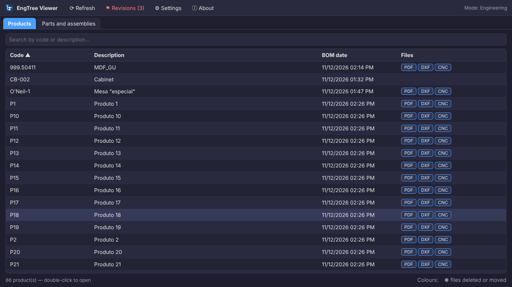

# EngTree Viewer

**English** · [Português (Brasil)](README.pt-BR.md) · [Guide](docs/GUIDE.md)

A small, fast desktop viewer for engineering BOMs. Open a product, see its Bill of Materials as a tree, click any part and its drawing, DXF or 3D file opens right next to it. When a drawing is wrong, the shop floor asks engineering to fix it from the same screen.

Made for the shop floor: one portable `.exe`, no install, no database, no account. It reads the spreadsheets and folders you already have (local or on a network share) and writes nothing to them. Runs well on old, low-spec PCs where heavier CAD viewers struggle.

## Features

- **BOM tree** from SolidWorks-style item numbers (1, 1.1, 1.1.1), with expand/collapse, filter, keyboard navigation and a right-click menu
- **Files linked to every part**: each row shows which file types exist for it (PDF, DXF, IGES…), with a one-click ZIP of all of them for the whole product
- **Built-in viewers**: PDF, DXF (2D) and IGES (3D, shaded) with zoom, pan, rotate and **measuring**; images, video, audio and text too. Anything else opens in its default program
- **Parts and assemblies tab**: every part of every BOM in one searchable list, with where it is used and filters by any spreadsheet column you choose; opening an assembly shows its own sub-tree
- **Revisions**: ask engineering to fix a part, see it in red everywhere until it is settled, close it with an answer and export the whole history as a spreadsheet. Records live in a shared folder — no server, no database
- **File list for machine programs**: mark a file type as *List* (CNC with `.mpr, .nc, .tap`…) to see every file of a part with date and size
- **Drawing revisions**: several files matching one part (`ABC-100_rev2.pdf`) are offered in a picker, exact name first, then newest
- **Attachments** (📎): photos, videos and documents kept in a folder or file named after the code
- **Your spreadsheets, your columns**: `.xlsx`, `.csv` (comma or semicolon) or tab-separated `.txt`. Only four key columns need to be found (item, code, description, quantity); every other column is shown as it is
- **English and Portuguese (Brazil)** interface: follows the system language, or pick one in Settings
- **Shared settings**: point every computer at one `engtree.json` on the network; engineering sets the folders once
- **Offline-friendly**: if the network share drops, a red bar says so and the lists keep working from the last scan

## Install

1. Download `EngTreeViewer.exe` from [Releases](https://github.com/ALEXKAKIUCHI/engtree-viewer/releases) (or the `.zip`, which also carries the guides and a sample settings file).
2. Put it anywhere and double-click it. No installer, no administrator rights, nothing in Program Files.
3. The first time, Windows shows **"Windows protected your PC"**, because the file is not code-signed: click **More info → Run anyway**.
4. In **Settings**, point EngTree at your folders.

Requirements: Windows 10 or 11, and Microsoft Edge or Google Chrome (Edge ships with Windows, so there is nothing to install). To build it yourself: [Go](https://go.dev/dl/) 1.21+ and `build.bat`.

Settings are saved in `%APPDATA%\EngTreeViewer\engtree.json`. If a file named `engtree.json` sits **next to the .exe**, that one is used instead, which makes the install portable.

## Getting started

| What | Example | Notes |
|---|---|---|
| BOM | `BOM - ABC-100 - Side table.xlsx` | code and description come from the name, split by the separator (` - `) |
| Details (optional) | `PARTS - ABC-100.xlsx` | same folder as the BOM, joined to it by part code |
| Part file, exact match | `ABC-110.dxf` | name = part code |
| Part file, prefix match | `ABC-110 - Leg.pdf`, `ABC-110_rev2.pdf` | name starts with the code followed by a separator. `ABC-1100.pdf` does **not** match `ABC-110` |

The BOM header row is found automatically, and column names are matched ignoring case, accents and punctuation, with alternatives separated by `|`. The defaults cover SolidWorks in English and Portuguese. If your headers vary, a column can also be given by position: `#2` means the 2nd column.

The full walkthrough, with pictures, is in the **[guide](docs/GUIDE.md)**. There is also a one-page [sheet for the shop floor](docs/MICROMANUAL.md) (in Portuguese) on how to ask for a revision.

## Privacy

EngTree Viewer:

- only **reads** the folders you set in Settings. The one folder it writes to is the revisions folder, and only when you set one: one small file per request, holding what you typed in the request window plus the computer's name;
- runs a local server bound to `127.0.0.1` (not reachable from other computers), serves files only from those folders and refuses requests coming from other web sites;
- sends **nothing** over the internet and has **no telemetry or data collection**. "Report a problem" just opens this project's GitHub page in your browser.

## Limitations

- True binary Excel `.xls` is not read: save as `.xlsx` or `.csv`. (Text exports that merely carry the `.xls` extension are read.)
- IGES curved faces are drawn faceted from their outline; it is a quick viewer, not a CAD kernel.
- Hierarchy comes from item numbers (1.2.1). BOMs with a separate "level" column are not supported yet.

## Roadmap

- A guided first run, instead of the plain settings screen
- Production list for a product with quantities
- Update check through GitHub Releases (optional, off with one click)
- Built-in "report a problem" with an exportable log for PCs without internet

## License

[MIT](LICENSE) © Alexsander Kakiuchi
