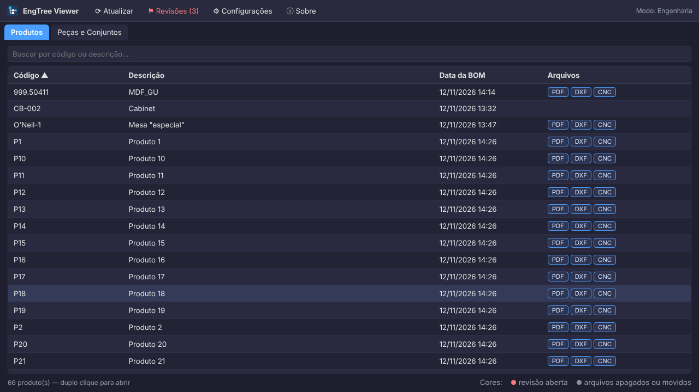

# EngTree Viewer

[English](README.md) · **Português (Brasil)** · [Guia](docs/GUIA.md)

Um visualizador leve e rápido de BOMs de engenharia. Abra um produto, veja a lista de materiais em árvore, clique em qualquer peça e o desenho, o DXF ou o arquivo 3D dela abre ao lado. Quando um desenho está errado, a fábrica pede a correção para a engenharia pela mesma tela.

Feito para o chão de fábrica: um único `.exe` portátil, sem instalação, sem banco de dados, sem conta. Ele lê as planilhas e pastas que você já tem (locais ou na rede) e não grava nada nelas. Roda bem em computadores antigos, onde visualizadores CAD mais pesados sofrem.

## Recursos

- **Árvore da BOM** pelos números de item no padrão SolidWorks (1, 1.1, 1.1.1), com expandir/recolher, filtro, navegação pelo teclado e menu de botão direito
- **Arquivos ligados a cada peça**: cada linha mostra quais tipos existem para ela (PDF, DXF, IGES…), com ZIP de todos eles do produto inteiro em um clique
- **Visualizadores embutidos**: PDF, DXF (2D) e IGES (3D sombreado) com zoom, arrasto, rotação e **medição**; imagem, vídeo, áudio e texto também. O resto abre no programa padrão
- **Aba Peças e Conjuntos**: todas as peças de todas as BOMs numa lista pesquisável, com onde cada uma é usada e filtros pelas colunas da planilha que você escolher; abrir um conjunto mostra a subárvore dele
- **Revisões**: peça a correção de uma peça, veja-a em vermelho em todas as telas até ser sanada, encerre com uma resposta e exporte o histórico em planilha. Os registros ficam numa pasta compartilhada — sem servidor, sem banco de dados
- **Lista de arquivos para programas de máquina**: marque um tipo como *Lista* (CNC com `.mpr, .nc, .tap`…) para ver todos os arquivos da peça com data e tamanho
- **Revisões de desenho**: vários arquivos da mesma peça (`ABC-100_rev2.pdf`) aparecem numa lista, nome exato primeiro, depois o mais recente
- **Anexos** (📎): fotos, vídeos e documentos guardados em uma pasta ou arquivo com o nome do código
- **Suas planilhas, suas colunas**: `.xlsx`, `.csv` (vírgula ou ponto e vírgula) ou `.txt` separado por tabulação. Só quatro colunas precisam ser encontradas (item, código, descrição, quantidade); as demais aparecem como estão
- **Interface em português e inglês**: segue o idioma do sistema, ou escolha nas Configurações
- **Configuração compartilhada**: aponte todos os computadores para um `engtree.json` na rede; a engenharia configura as pastas uma vez
- **Funciona offline**: se a rede cair, uma barra vermelha avisa e as listas continuam com os últimos dados lidos

## Instalação

1. Baixe o `EngTreeViewer.exe` em [Releases](https://github.com/ALEXKAKIUCHI/engtree-viewer/releases) (ou o `.zip`, que traz também os guias e um arquivo de configuração de exemplo).
2. Ponha onde quiser e dê dois cliques. Sem instalador, sem precisar de administrador, sem nada em Arquivos de Programas.
3. Na primeira vez, o Windows mostra **"O Windows protegeu o computador"**, porque o arquivo não é assinado digitalmente: clique em **Mais informações → Executar assim mesmo**.
4. Em **Configurações**, aponte as suas pastas.

Requisitos: Windows 10 ou 11 e Microsoft Edge ou Google Chrome (o Edge já vem com o Windows, então não há o que instalar). Para compilar: [Go](https://go.dev/dl/) 1.21+ e o `build.bat`.

As configurações ficam em `%APPDATA%\EngTreeViewer\engtree.json`. Se existir um `engtree.json` **ao lado do .exe**, ele é usado no lugar, o que deixa a instalação portátil.

## Como começar

| O quê | Exemplo | Observação |
|---|---|---|
| BOM | `BOM - ABC-100 - Mesa lateral.xlsx` | código e descrição vêm do nome, separados por ` - ` |
| Detalhes (opcional) | `PECAS - ABC-100.xlsx` | mesma pasta da BOM, ligada pelo código |
| Arquivo da peça, exato | `ABC-110.dxf` | nome = código |
| Arquivo da peça, prefixo | `ABC-110 - Perna.pdf`, `ABC-110_rev2.pdf` | `ABC-1100.pdf` **não** casa com `ABC-110` |

O cabeçalho da BOM é encontrado sozinho, e os nomes das colunas são comparados ignorando maiúsculas, acentos e pontuação, com alternativas separadas por `|`. O padrão cobre o SolidWorks em português e em inglês. Se os seus cabeçalhos variam, dá para indicar a coluna pela posição: `#2` é a segunda coluna.

O passo a passo completo, com imagens, está no **[guia](docs/GUIA.md)**. Há também uma [folha de uma página para a fábrica](docs/MICROMANUAL.md) sobre como pedir revisão.

## Privacidade

O EngTree Viewer:

- só **lê** as pastas que você configurar. A única pasta em que ele grava é a de revisões, e apenas se você configurar uma: um arquivo pequeno por pedido, com o que você digitou na janela de solicitação e o nome do computador;
- roda um servidor local em `127.0.0.1` (inacessível de outros computadores), só entrega arquivos dessas pastas e recusa pedidos vindos de outros sites;
- **não envia nada pela internet** e **não coleta dados**. "Reportar um problema" apenas abre a página do projeto no GitHub.

## Limitações

- O Excel `.xls` binário de verdade não é lido: salve como `.xlsx` ou `.csv`. (Exportações em texto que só têm a extensão `.xls` são lidas.)
- Faces curvas do IGES aparecem facetadas; é um visualizador rápido, não um CAD.
- A hierarquia vem do número do item (1.2.1). BOMs com coluna de "nível" ainda não são suportadas.

## Roadmap

- Um assistente na primeira abertura, no lugar da tela de configurações crua
- Lista de produção de um produto, com quantidades
- Verificação de atualização pelo GitHub Releases (opcional, desligável)
- "Reportar um problema" embutido, com log exportável para computadores sem internet

## Licença

[MIT](LICENSE) © Alexsander Kakiuchi
