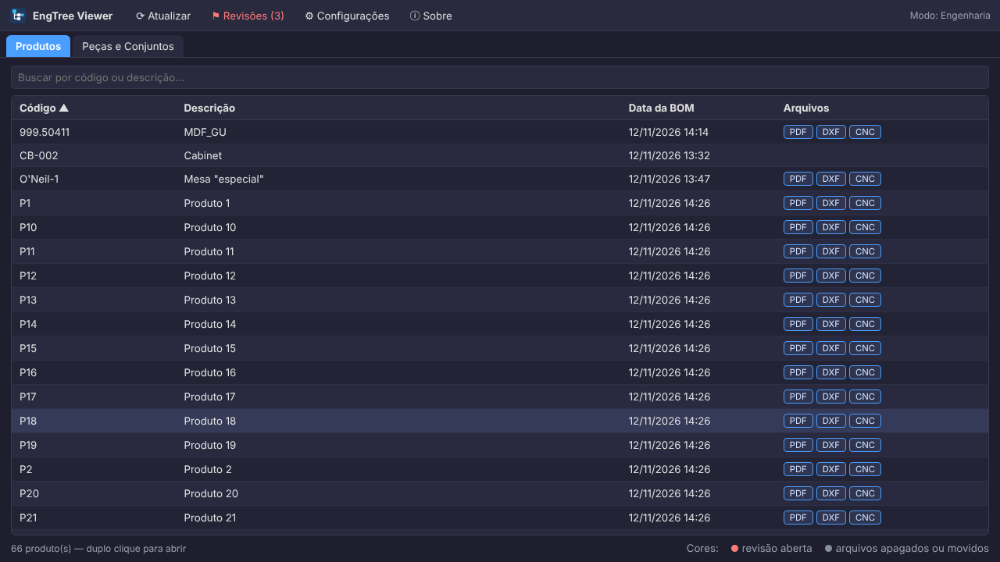
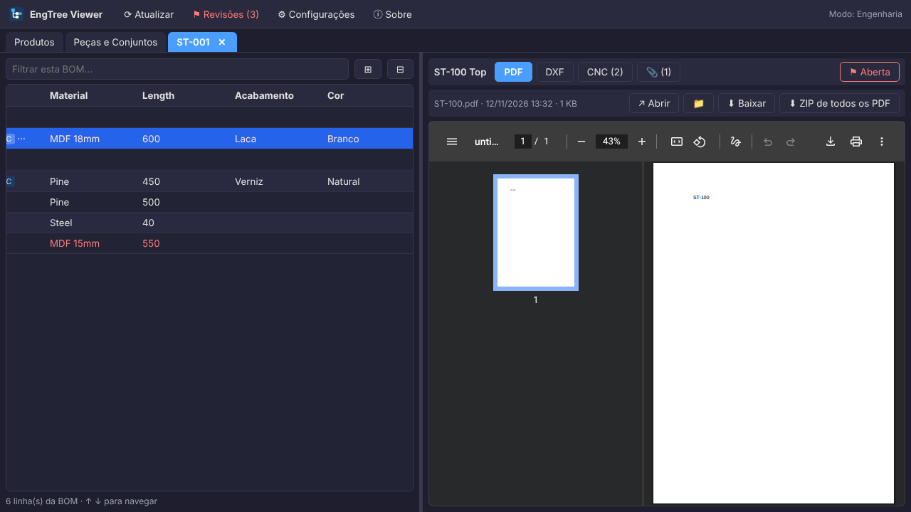
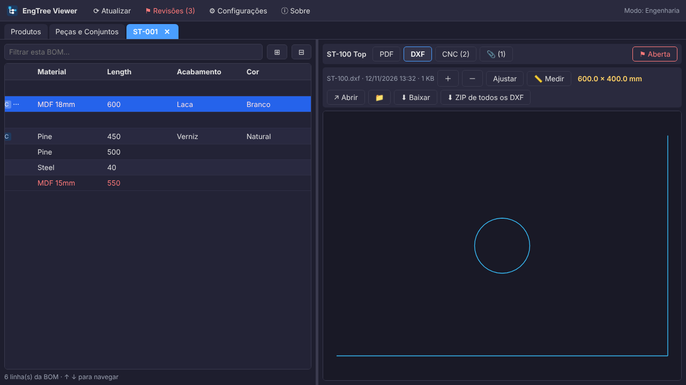
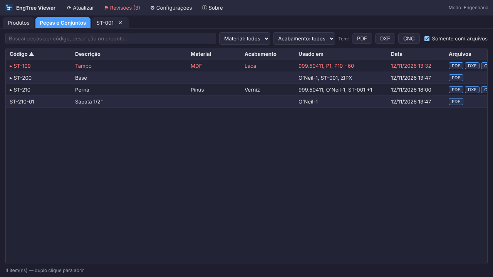
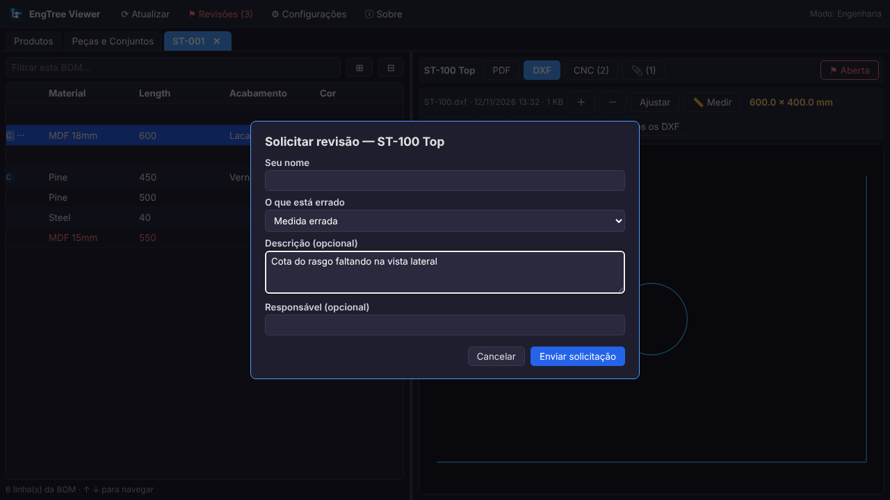
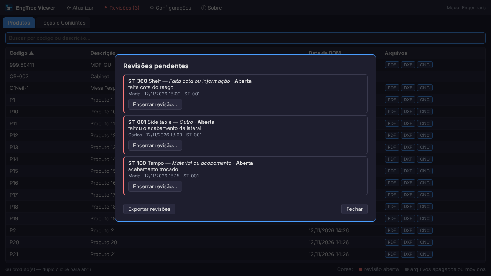
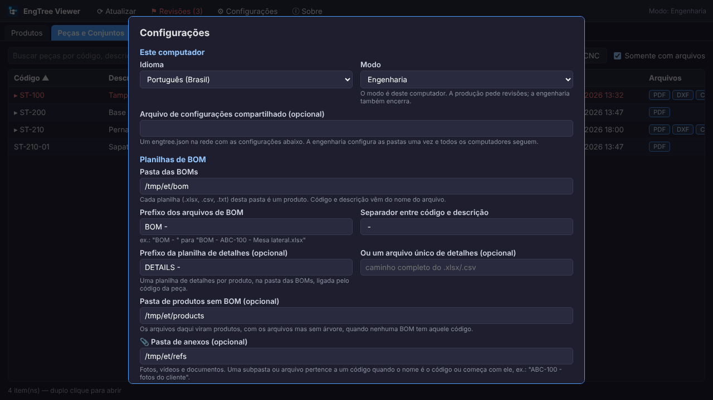

# Guia do EngTree Viewer

[English](GUIDE.md)

Este guia cobre tudo o que o EngTree faz e as particularidades de cada configuração. Para pedir revisão na fábrica, há uma folha de uma página: [micromanual](MICROMANUAL.md).

---

## 1. Instalar

O EngTree é um executável só, portátil. Não tem instalador, não vai para Arquivos de Programas e não precisa de administrador.

1. Baixe o `EngTreeViewer.exe` em [Releases](https://github.com/ALEXKAKIUCHI/engtree-viewer/releases).
2. Coloque onde quiser: Área de Trabalho, uma pasta do computador ou uma pasta da rede.
3. Dê dois cliques.

Na primeira vez, o Windows mostra a tela azul **"O Windows protegeu o computador"**, porque o arquivo não é assinado digitalmente. Clique em **Mais informações → Executar assim mesmo**. Isso acontece uma vez por computador.

A janela do programa é o Microsoft Edge (ou o Chrome) em modo aplicativo, sem barra de endereço. O Edge já vem com o Windows 10 e 11, então não há nada para instalar.

### Onde ficam as configurações

| Situação | Arquivo |
|---|---|
| Normal | `%APPDATA%\EngTreeViewer\engtree.json` |
| Portátil | um `engtree.json` ao lado do `.exe` — se esse arquivo existir, ele é usado |

O modo portátil serve para levar a instalação num pen drive, ou para copiar a mesma configuração para vários computadores: basta copiar o `.exe` e o `engtree.json` juntos.

---

## 2. A tela de Produtos

Cada planilha de BOM da pasta configurada é um produto. A coluna **Arquivos** mostra o que existe para aquele produto ou para as peças dele; clicar num deles baixa um ZIP com todos os arquivos daquele tipo do produto inteiro.

- **Um clique** seleciona a linha, **dois cliques** abrem o produto numa aba.
- As setas **↑ ↓** andam na lista e o **Enter** abre, inclusive com o cursor na caixa de busca.
- O **botão direito** abre o menu com copiar código, abrir arquivo, mostrar na pasta, ZIP e as revisões.
- As colunas podem ser **arrastadas pela borda** para mudar a largura e **arrastadas pelo título** para mudar de lugar. Fica salvo. Para voltar ao normal, botão direito no cabeçalho → *Restaurar colunas*.

### Cores

| Cor | Significado |
|---|---|
| Vermelho | a peça tem revisão aberta |
| Cinza riscado | a peça tinha arquivos e agora não tem nenhum: apagado ou movido |

---

## 3. O produto aberto

À esquerda, a árvore da BOM, montada pelo número do item (1, 1.1, 1.1.1). A primeira linha é o próprio produto. À direita, os arquivos da peça selecionada.

- Os botões no alto da direita são os tipos de arquivo que a peça tem. O EngTree mantém o tipo escolhido ao andar pela árvore: se você está vendo PDFs, continua vendo PDFs ao descer de peça.
- **⊞ / ⊟** expandem e recolhem a árvore toda; a caixa de filtro apaga as linhas que não batem, sem perder a hierarquia.
- O divisor no meio pode ser arrastado.

### Visualizadores

| Tipo | O que acontece |
|---|---|
| PDF | abre na tela |
| DXF | desenho 2D com zoom, arrasto e **medição** |
| IGES | 3D sombreado, com rotação e medição |
| Imagem, vídeo, áudio, texto | abrem na tela |
| Qualquer outro | botão para abrir no programa padrão do Windows |

A medição funciona assim: clique em **📏 Medir**, depois clique numa linha para ver o comprimento dela, ou em dois pontos para ver a distância entre eles. Enquanto nada está medido, aparece o tamanho total da peça.

### Revisões do arquivo

Quando a mesma peça tem vários arquivos do mesmo tipo (`ABC-100.pdf` e `ABC-100_rev2.pdf`), aparece uma lista para escolher. A ordem é: nome exato primeiro, depois o mais recente.

---

## 4. Peças e Conjuntos

Esta aba junta todas as peças de todas as BOMs numa lista só.

- **Usado em** mostra em quais produtos a peça aparece. Digitar o código de um produto na busca filtra por ele.
- Os filtros do alto vêm das colunas que você escolher nas Configurações (Material, Acabamento…), mais os botões **Tem: PDF / DXF / CNC** e a caixa **Somente com arquivos**.
- Os conjuntos aparecem com ▸ e, ao abrir, mostram a subárvore deles.

O índice é montado uma vez e guardado. Nas próximas vezes, só as planilhas que mudaram de data são lidas de novo, o que importa quando as BOMs estão numa pasta de rede.

---

## 5. Revisões

Serve para a fábrica avisar a engenharia de que um desenho está errado, sem telefone, sem papel e sem e-mail perdido.

**Como funciona:** cada pedido vira um arquivo pequeno numa pasta compartilhada da rede. Não há servidor nem banco de dados, e dois computadores nunca escrevem no mesmo arquivo. Nada é apagado, então o histórico fica.

Para ligar, basta preencher **Pasta de revisões** nas Configurações. Se a pasta não estiver acessível, o pedido fica desabilitado até a rede voltar; o resto do programa continua funcionando.

### Os dois modos

O modo é **do computador**, não da pessoa: não existe login nem senha.

| Modo | O que pode |
|---|---|
| **Produção** | vê o vermelho e o motivo, e pede revisão |
| **Engenharia** | tudo isso, mais o aviso de pendentes ao abrir, encerrar revisão e exportar o relatório |

### Pedir uma revisão

Botão direito na peça → **Solicitar revisão**. A janela pede:

- **Seu nome** — o último nome usado naquele computador já vem preenchido na próxima vez;
- **O que está errado** — medida errada, falta cota ou informação, material ou acabamento, arquivo errado ou faltando, outro;
- **Descrição** — opcional, mas obrigatória quando o tipo é "outro";
- **Responsável** — opcional, se já se sabe quem vai resolver.

A peça fica vermelha em todas as telas e em todos os computadores.

### Encerrar

No modo Engenharia, o aviso de pendentes aparece ao abrir o programa, com a lista clicável. Cada item tem **Encerrar revisão**, que pede uma resposta curta.

O vermelho também sai sozinho quando o arquivo da peça é substituído por um mais novo: nesse caso a revisão fica como *Sanada (arquivo substituído)*. Isso evita que a lista fique cheia de pendências que já foram resolvidas no desenho.

### Relatório

No modo Engenharia, **Exportar revisões** gera uma planilha (`.csv`, separada por `;`, que o Excel abre com dois cliques) com peça, descrição, produto, solicitante, data, tipo, motivo, responsável, status, data da solução e resposta.

---

## 6. Configurações

### Pastas

| Campo | Para que serve |
|---|---|
| **Pasta das BOMs** | onde estão as planilhas. Cada planilha é um produto |
| **Prefixo dos arquivos de BOM** | ex.: `BOM - `. Vazio = toda planilha da pasta é uma BOM |
| **Separador** | o que separa código e descrição no nome do arquivo (` - `) |
| **Prefixo da planilha de detalhes** | planilha opcional por produto, ligada pelo código da peça |
| **Arquivo único de detalhes** | a mesma ideia, mas um arquivo só para tudo |
| **Pasta de produtos sem BOM** | os arquivos daqui viram produtos (sem árvore) quando nenhuma BOM tem aquele código |
| **📎 Pasta de anexos** | fotos, vídeos e documentos |
| **Pasta de revisões** | a única pasta em que o EngTree grava |

### Nomes dos arquivos

| O quê | Exemplo |
|---|---|
| BOM | `BOM - ABC-100 - Mesa lateral.xlsx` |
| Detalhes | `PECAS - ABC-100.xlsx` |
| Arquivo da peça (exato) | `ABC-110.dxf` |
| Arquivo da peça (prefixo) | `ABC-110 - Perna.pdf`, `ABC-110_rev2.pdf` |
| Anexo | uma subpasta `ABC-100 - fotos do cliente` ou um arquivo `ABC-100 nota.txt` |

No modo prefixo, `ABC-1100.pdf` **não** casa com `ABC-110`. E se a BOM tem `ABC-110` e também `ABC-110-01`, o arquivo `ABC-110-01.pdf` pertence só à `ABC-110-01`.

### Formatos de planilha

`.xlsx`, `.csv` (vírgula ou ponto e vírgula) e `.txt` separado por tabulação. Um arquivo com extensão `.xls` é lido quando por dentro é texto ou `.xlsx` — o que acontece com muita exportação de CAD. O `.xls` binário antigo de verdade não é lido: salve como `.xlsx`.

### Colunas

O EngTree só precisa achar quatro colunas: item, código, descrição e quantidade. As outras aparecem como estão.

Os nomes aceitam alternativas separadas por `|`, e maiúsculas, acentos e pontuação são ignorados — `Nº DO ITEM`, `N do item` e `ITEM NO.` são a mesma coisa. Se o cabeçalho das suas planilhas varia demais, dá para usar a **posição**: `#1` é a primeira coluna, `#2` a segunda, e assim por diante.

**Colunas da aba Peças** são as que aparecem (e viram filtro) em Peças e Conjuntos.

### Tipos de arquivo

Cada linha é um tipo: nome, extensões, pastas (várias separadas por `;`) e como o nome casa com o código.

A caixa **Lista** muda o comportamento: em vez de abrir o primeiro arquivo, mostra todos os arquivos da peça com data e tamanho, com botões para ver, abrir, mostrar na pasta, baixar e gerar um ZIP. É o modo certo para programas de CNC, em que cada empresa usa os seus formatos.

### Configuração compartilhada

Em vez de configurar cada computador, coloque um `engtree.json` numa pasta da rede e aponte o campo **Arquivo de configurações compartilhado** para ele. A partir daí:

- as pastas, colunas e tipos de arquivo vêm desse arquivo, em todos os computadores;
- continuam sendo de cada máquina: **idioma**, **modo**, e a largura e a ordem das colunas;
- num computador em modo Engenharia os campos ficam editáveis e salvar grava no arquivo compartilhado; nos outros, ficam só de leitura;
- se a rede cair, o EngTree usa a última cópia que leu, em vez de ficar sem configuração.

Para implantar em várias máquinas: copie o `.exe` e um `engtree.json` com só três linhas (idioma, modo e o caminho do compartilhado) para cada uma.

---

## 7. Privacidade

O EngTree lê as pastas que você configurar e **grava apenas na pasta de revisões**. Ele roda um servidor local em `127.0.0.1`, que não é alcançável de outro computador, só entrega arquivos das pastas configuradas e recusa pedidos vindos de outros sites abertos no navegador. Não envia nada pela internet e não coleta dados. O item "Reportar um problema" apenas abre a página do projeto no GitHub.
