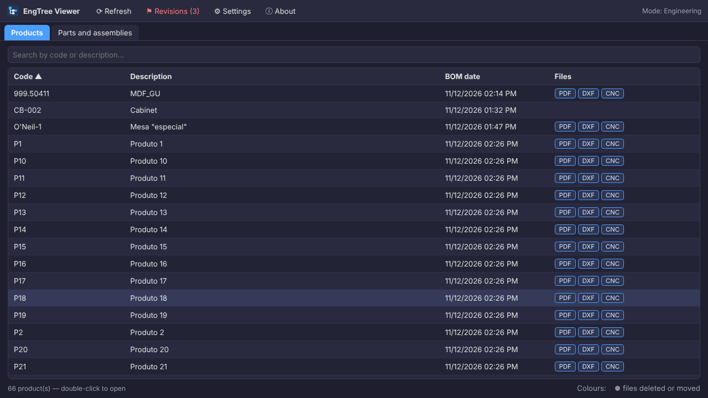
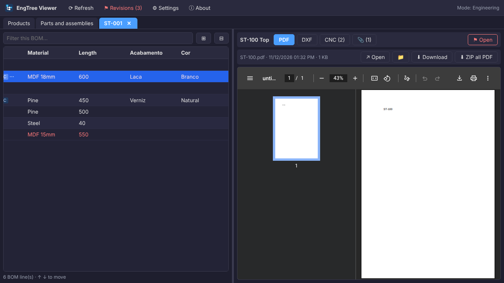
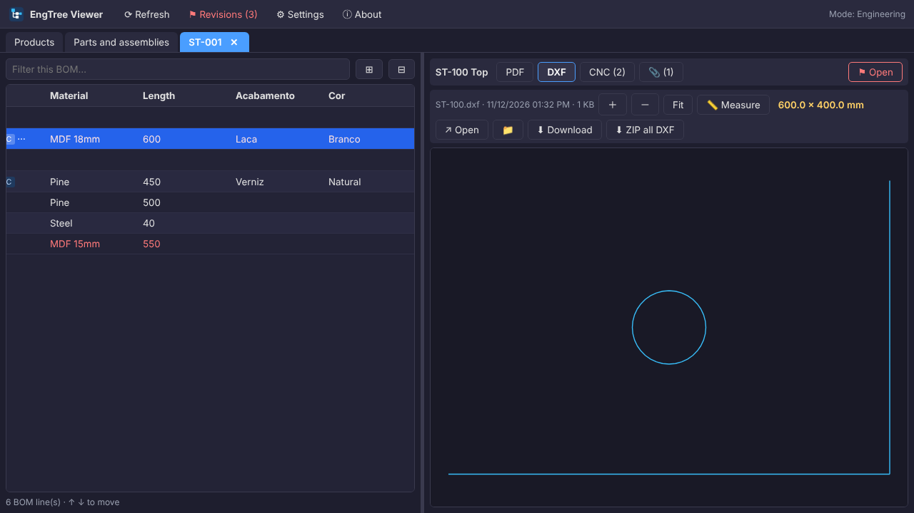
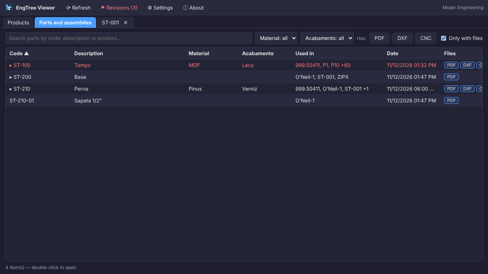
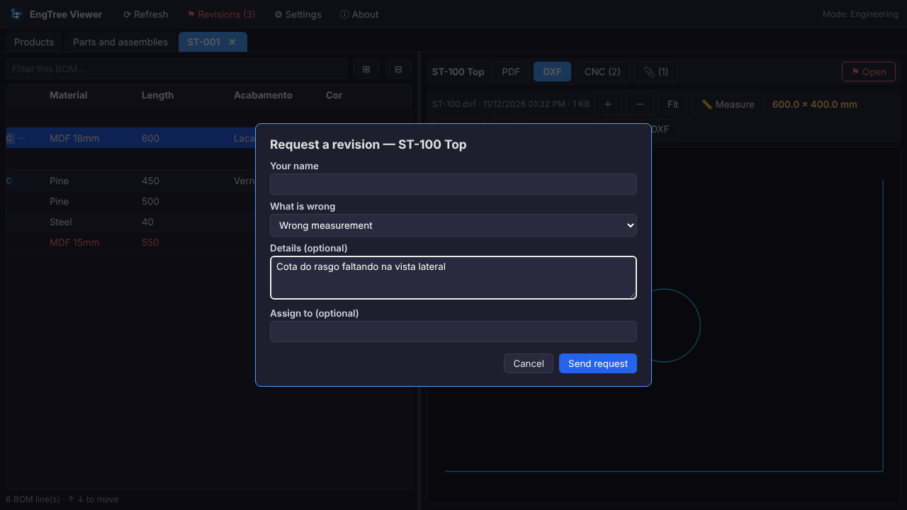
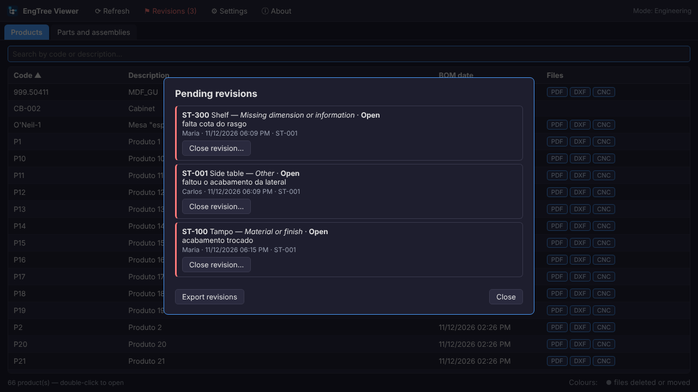
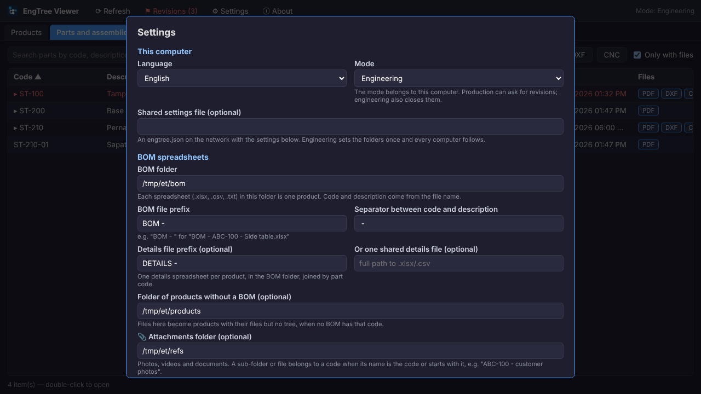

# EngTree Viewer guide

[Português (Brasil)](GUIA.md)

Everything EngTree does, and the details of each setting.

---

## 1. Install

EngTree is a single portable executable. No installer, nothing in Program Files, no administrator rights.

1. Download `EngTreeViewer.exe` from [Releases](https://github.com/ALEXKAKIUCHI/engtree-viewer/releases).
2. Put it anywhere: desktop, a folder on the PC, or a network folder.
3. Double-click it.

The first time, Windows shows the blue **"Windows protected your PC"** screen, because the file is not code-signed. Click **More info → Run anyway**. It happens once per computer.

The window is Microsoft Edge (or Chrome) in app mode, with no address bar. Edge ships with Windows 10 and 11, so there is nothing else to install.

### Where the settings live

| Case | File |
|---|---|
| Normal | `%APPDATA%\EngTreeViewer\engtree.json` |
| Portable | an `engtree.json` next to the `.exe` — if that file exists, it wins |

Portable mode is handy on a pen drive, or to copy one setup to several computers: copy the `.exe` and the `engtree.json` together.

---

## 2. The products screen

Every BOM spreadsheet in the configured folder is a product. The **Files** column shows what exists for that product or its parts; clicking one downloads a ZIP with every file of that type for the whole product.

- **One click** selects a row, **double click** opens the product in a tab.
- **↑ ↓** move through the list and **Enter** opens, even while the cursor is in the search box.
- **Right-click** opens the menu: copy code, open file, show in folder, ZIP and the revisions.
- Columns can be **dragged by the edge** to resize and **dragged by the title** to reorder; both are remembered. Right-click the header → *Restore columns* to go back.

### Colours

| Colour | Meaning |
|---|---|
| Red | the part has an open revision |
| Grey italic | the part had files and now has none: deleted or moved |

---

## 3. A product open

On the left, the BOM tree, built from the item numbers (1, 1.1, 1.1.1); the first row is the product itself. On the right, the files of the selected part.

- The buttons at the top right are the file types that part has. EngTree keeps the type you picked while you move through the tree: if you are looking at PDFs, you keep seeing PDFs.
- **⊞ / ⊟** expand and collapse everything; the filter box dims what does not match without breaking the hierarchy.
- The divider in the middle can be dragged.

### Viewers

| Type | What happens |
|---|---|
| PDF | opens in place |
| DXF | 2D drawing with zoom, pan and **measuring** |
| IGES | shaded 3D, with rotation and measuring |
| Image, video, audio, text | open in place |
| Anything else | a button opens it in its default Windows program |

Measuring: click **📏 Measure**, then click a line for its length, or two points for the distance between them. With nothing measured, the box shows the overall size of the part.

### File revisions

When a part has several files of the same type (`ABC-100.pdf` and `ABC-100_rev2.pdf`), a picker appears. The order is: exact name first, then newest.

---

## 4. Parts and assemblies

This tab merges every part of every BOM into one list.

- **Used in** shows which products contain the part. Typing a product code in the search filters by it.
- The filters at the top come from the columns you choose in Settings (Material, Finish…), plus the **Has: PDF / DXF / CNC** buttons and the **Only with files** box.
- Assemblies are marked with ▸ and open showing their own sub-tree.

The index is built once and cached. After that, only spreadsheets whose date changed are read again, which matters when the BOMs live on a network share.

---

## 5. Revisions

This is how the shop floor tells engineering that a drawing is wrong, without a phone call, a printout or a lost email.

**How it works:** each request becomes one small file in a shared network folder. No server, no database, and two computers never write to the same file. Nothing is deleted, so the history stays.

To turn it on, fill in **Revisions folder** in Settings. If the folder cannot be reached, requesting is disabled until the network is back; the rest of the program keeps working.

### The two modes

The mode belongs to the **computer**, not to a person: there is no login.

| Mode | What it can do |
|---|---|
| **Production** | sees the red and the reason, and asks for revisions |
| **Engineering** | all of that, plus the pending alert on start, closing revisions and exporting the report |

### Asking for a revision

Right-click a part → **Request a revision**. The window asks for:

- **Your name** — the last name used on that computer comes back filled in next time;
- **What is wrong** — wrong measurement, missing dimension or information, material or finish, wrong or missing file, other;
- **Details** — optional, but required when the type is "other";
- **Assign to** — optional.

The part turns red on every screen and on every computer.

### Closing

In engineering mode the pending alert opens with the program, listing what is waiting, each item clickable. **Close revision** asks for a short answer.

The red also clears on its own when the part's file is replaced by a newer one; the revision is then recorded as *Settled (file replaced)*. That keeps the list from filling up with requests already fixed in the drawing.

### Report

In engineering mode, **Export revisions** writes a spreadsheet (`.csv`, semicolon separated, which Excel opens with a double click) with part, description, product, requester, date, type, reason, assignee, status, settled date and answer.

---

## 6. Settings

### Folders

| Field | What it is for |
|---|---|
| **BOM folder** | where the spreadsheets are. Each one is a product |
| **BOM file prefix** | e.g. `BOM - `. Empty = every spreadsheet is a BOM |
| **Separator** | between code and description in the file name (` - `) |
| **Details file prefix** | optional spreadsheet per product, joined by part code |
| **Shared details file** | same idea, one file for everything |
| **Folder of products without a BOM** | files here become products (with no tree) when no BOM has that code |
| **📎 Attachments folder** | photos, videos and documents |
| **Revisions folder** | the only folder EngTree writes to |

### File naming

| What | Example |
|---|---|
| BOM | `BOM - ABC-100 - Side table.xlsx` |
| Details | `PARTS - ABC-100.xlsx` |
| Part file (exact) | `ABC-110.dxf` |
| Part file (prefix) | `ABC-110 - Leg.pdf`, `ABC-110_rev2.pdf` |
| Attachment | a sub-folder `ABC-100 - customer photos` or a file `ABC-100 note.txt` |

With prefix matching, `ABC-1100.pdf` does **not** match `ABC-110`. And if the BOM has both `ABC-110` and `ABC-110-01`, the file `ABC-110-01.pdf` belongs to `ABC-110-01` only.

### Spreadsheet formats

`.xlsx`, `.csv` (comma or semicolon) and tab-separated `.txt`. A file with the `.xls` extension is read when it is really text or an `.xlsx` inside, which is what many CAD exports produce. A true old binary `.xls` is not read: save it as `.xlsx`.

### Columns

EngTree only needs to find four columns: item, code, description and quantity. Everything else is shown as it is.

Names accept alternatives separated by `|`, and case, accents and punctuation are ignored — `Nº DO ITEM`, `N do item` and `ITEM NO.` are the same thing. If your headers vary too much, use the **position** instead: `#1` is the first column, `#2` the second, and so on.

**Columns in the Parts tab** are the ones shown, and usable as filters, in Parts and assemblies.

### File types

Each row is a type: name, extensions, folders (several separated by `;`) and how the file name matches the code.

The **List** box changes the behaviour: instead of opening the first file, it shows every file of that part with date and size, with buttons to view, open, show in folder, download and zip. That is the right mode for CNC programs, where each company uses its own formats.

### Shared settings

Instead of configuring every computer, put an `engtree.json` in a network folder and point **Shared settings file** at it. From then on:

- folders, columns and file types come from that file, on every computer;
- **language**, **mode**, and column widths and order stay per machine;
- on a computer in engineering mode the fields stay editable and saving writes to the shared file; elsewhere they are read-only;
- if the network drops, EngTree uses the last copy it read.

To roll out to several machines: copy the `.exe` and an `engtree.json` with three lines (language, mode and the shared path) to each one.

---

## 7. Privacy

EngTree reads the folders you configure and **writes only to the revisions folder**. It runs a local server bound to `127.0.0.1`, not reachable from another computer, serves files only from the configured folders, and refuses requests coming from other web sites open in the browser. It sends nothing over the internet and collects no data. "Report a problem" only opens this project's GitHub page.
